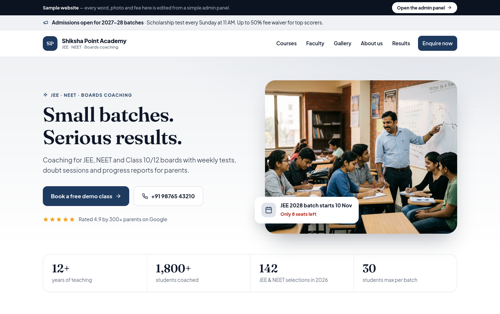

# Institute CMS

A browser-only management app **and** website builder for small coaching institutes, tuition centres, dance/music academies and clinics.

**Live demo:** https://demo-institute-cms.vercel.app (opens on the public website; `?mode=clinic` for the clinic version, “Open the admin panel” for the back office)



## What it does
- **Website editor** with live desktop/mobile preview: name, tagline, brand colour, headline, highlights, about, contact details, timings, optional WhatsApp button.
- **Website content:** courses / services with fees and batch timings, faculty / doctors, gallery, announcements (pinned notice in the top bar), extra pages (About, Results, Policy…).
- **Public website** (premium template: photo hero, stats, why-us, course cards, testimonials, faculty, bento gallery, notice board, mobile call/enquire bar) with a validated enquiry / appointment form that lands straight in the admin inbox.
- **Enquiries:** status tracking (New → Contacted → Converted → Closed), one-click convert to a student/patient.
- **Students / patients:** profile, enrolments or appointments, payments, dues, attendance or visit history.
- **Fees & payments:** record payments (UPI / cash / card / bank / cheque), printable receipts (amount in words, Indian numbering), CSV export.
- **Attendance register** per batch and date (institute) or **visit notes / prescriptions** (clinic).
- **Dashboard:** new enquiries, fees due, collections, today's schedule.
- Switch between **Coaching institute** and **Clinic** mode in Settings. Backup / restore as JSON.

## Tech
Plain HTML/CSS/JavaScript, no build step, no backend. Data is stored in the browser's `localStorage`. Deploy anywhere that serves static files.

```
index.html  styles.css  app.js  img/ (demo photos)  fonts/ (Plus Jakarta Sans + Fraunces, self-hosted)
```

Quality rubric and review log: [QUALITY.md](QUALITY.md).

Built by [Rishabh Gusain](https://r69shabh.me).
